# Informe técnico: Clasificación de razas de gatos mediante Redes Neuronales Convolucionales (CNN)

**Asignatura:** TLY1102 – Técnicas de Machine Learning I (Duoc UC, Ingeniería en Informática mención Inteligencia Artificial)
**Evaluación:** 2 (CNN)
**Grupo 7:** Agustín Fernández, Sebastián Salgado, Eduardo Uribe
**Fecha:** 13 de Octubre 2026

---

## Resumen

Este informe documenta el desarrollo de una Red Neuronal Convolucional (CNN) en TensorFlow/Keras para clasificar imágenes de 12 razas de gatos del Oxford-IIIT Pet Dataset. El problema y la variante son los mismos de la Evaluación 1, donde se usó un Perceptrón Multicapa (MLP), de modo que ambos modelos pueden compararse sobre el mismo conjunto de prueba.

La CNN diseñada alcanzó 0,349 de accuracy y 0,341 de F1 macro en prueba, frente a 0,269 y 0,251 del MLP, con un80 % menos de parámetros. El modelo sobreajusta y su desempeño absoluto es modesto, lo que se explica por el tamaño del conjunto, la similitud visual entre razas, la resolución de 64 × 64 px.

---

## 1. Descripción del problema

Se debe clasificar automáticamente la raza de un gato a partir de una fotografía. Es un problema multiclase de 12 clases y de grano fino: varias razas comparten color, tamaño y rasgos faciales, por lo que las diferencias relevantes están en texturas y detalles locales del pelaje y del rostro.

En la Evaluación 1 el problema se resolvió con un MLP, que exige aplanar la imagen en un vector de 12.288 valores y, con ello, destruye la vecindad espacial entre píxeles. El objetivo de esta evaluación es implementar una CNN, que conserva la imagen como tensor 2D con canales de color y aprende filtros locales y jerárquicos, y cuantificar con evidencia experimental cuánto mejora frente al MLP.

### Pertinencia de comparar CNN y MLP

Ambos modelos resuelven el mismo problema con los mismos datos, la misma resolución, la misma normalización y la misma partición, por lo que la diferencia de desempeño puede atribuirse principalmente a la arquitectura (filtros convolucionales con pesos compartidos frente a capas densas sobre la imagen aplanada).

### Consideraciones éticas

- **Datos:** imágenes de animales de acceso público, sin información personal.
- **Uso previsto:** apoyo a la identificación visual; las decisiones críticas deben ser supervisadas por un experto.
- **Interpretabilidad:** para evitar el efecto de "caja negra" se visualizan Feature Maps y mapas de activación Grad-CAM, que muestran en qué zonas de la imagen se apoya el modelo.

---

## 2. Conjunto de datos y variante del grupo

Se usa el Oxford-IIIT Pet Dataset. La variante se describe a continuación.

| Decisión | Detalle | Justificación |
|---|---|---|
| Subconjunto | Solo gatos (`SPECIES == 1`): 12 razas; se descartan los perros | Clasificación multiclase acotada y abordable en el tiempo de la evaluación |
| Partición | 80 % entrenamiento / 20 % prueba por raza (seed 29); del 80 %, un 20 % para validación | Mantiene el balance de clases y es la misma partición del MLP, lo que permite comparar con equidad |
| Resolución | 64 × 64 px, RGB | Misma entrada que el MLP |

**Tamaños resultantes:** entrenamiento 1.517 imágenes, validación 379, prueba 475 (total 2.371).

Las razas son: Abyssinian, Bengal, Birman, Bombay, British_Shorthair, Egyptian_Mau, Maine_Coon, Persian, Ragdoll, Russian_Blue, Siamese y Sphynx. Con entre 147 y 160 imágenes por raza en el 80 % de entrenamiento y entre 37 y 40 en prueba, el conjunto está casi balanceado.

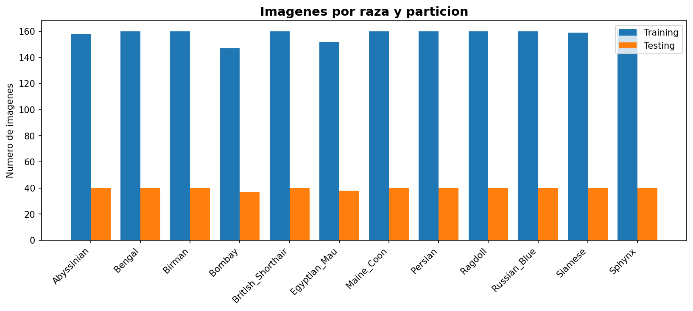

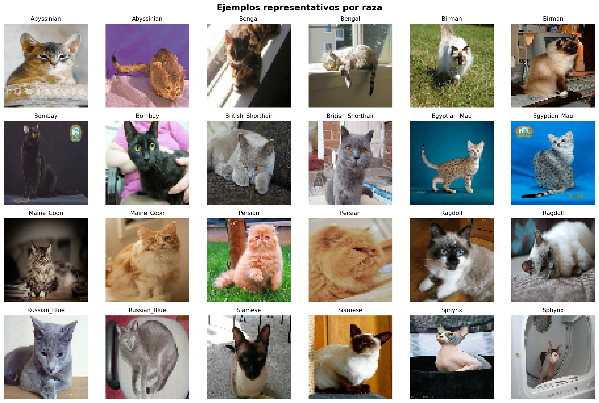

---

## 3. Preparación de los datos para la CNN

1. **Descarga y partición:** se descarga el dataset, se filtran los gatos, se organizan por raza y se separa 80 % / 20 % (entrenamiento / prueba) con seed 29.
2. **Conservación del formato matricial:** cada imagen es un tensor `(64, 64, 3)` que no se aplana durante las capas convolucionales.
3. **Redimensionamiento:** 64 × 64 px, igual que el MLP.
4. **Normalización:** división por 255, rango [0, 1], lo que estabiliza el gradiente y acelera la convergencia.
5. **Validación:** 20 % del conjunto de entrenamiento mediante image_dataset_from_directory con validation_split=0.2, shuffle=True y la misma seed, sin solapamiento con el entrenamiento.
6. **Visualización** de ejemplos representativos por raza.

### Adaptación respecto a la Evaluación 1

El MLP aplana la imagen (capaFlatten) antes de sus capas densas, por lo que solo ve un vector de 12.288 valores. La CNN mantiene los tensores (64, 64, 3) y aplana únicamente al final, después de extraer características. Se conservan resolución, normalización y partición, y se agrega un conjunto de validación para monitorear el aprendizaje.

### Corrección importante respecto a la Evaluación 1

En la Evaluación 1 el conjunto de validación se creó con shuffle=False, lo que en Keras impide mezclar los archivos antes de dividir y provoca que la validación se solape con el entrenamiento. Por eso la validación del MLP resultaba inflada respecto de la prueba. En esta evaluación la validación usa shuffle=True y se verifica que no comparte imágenes con el entrenamiento.

---

## 4. Diseño de la CNN

Arquitectura de 3 bloques Conv + MaxPooling seguidos de un clasificador denso.

| Capa | Salida | Parámetros |
|---|---|---|
| Entrada | 64 × 64 × 3 | 0 |
| Convolucion_1: Conv2D 16 filtros 3×3, ReLU | 62 × 62 × 16 | 448 |
| Pooling_1: MaxPooling 2×2 | 31 × 31 × 16 | 0 |
| Convolucion_2: Conv2D 32 filtros 3×3, ReLU | 29 × 29 × 32 | 4.640 |
| Pooling_2: MaxPooling 2×2 | 14 × 14 × 32 | 0 |
| Convolucion_3: Conv2D 64 filtros 3×3, ReLU | 12 × 12 × 64 | 18.496 |
| Pooling_3: MaxPooling 2×2 | 6 × 6 × 64 | 0 |
| Aplanado: Flatten | 2.304 | 0 |
| Densa_1: Dense 128, ReLU | 128 | 295.040 |
| Salida: Dense 12, softmax | 12 | 1.548 |
| **Total** | | **320.172** |

### Justificación de las decisiones

| Componente | Decisión | Justificación técnica |
|---|---|---|
| Capas convolucionales | 3 (16 → 32 → 64 filtros) | Permiten una jerarquía bordes/colores → texturas → partes (orejas, ojos). Se usan pocos filtros porque con ~1.500 imágenes una red más grande memoriza con facilidad |
| Tamaño de filtro | 3 × 3, padding="valid" | Kernels pequeños apilados tienen un campo receptivo amplio con pocos parámetros (estilo VGG) |
| Activación | ReLU en capas ocultas | No satura para valores positivos (evita el desvanecimiento del gradiente) y es barata de calcular |
| Pooling | MaxPooling 2 × 2 tras cada convolución | Reduce a la mitad alto y ancho, disminuye parámetros y da invarianza a pequeñas traslaciones; conserva el rasgo más intenso de cada ventana |
| Aplanado | Flatten (64 × 6 × 6 = 2.304) | Pasa del mapa de características al clasificador |
| Capa densa | 128 neuronas, ReLU | Combina las características extraídas; tamaño moderado para limitar la capacidad de memorizar |
| Salida | 12 neuronas, softmax | Distribución de probabilidad sobre las 12 razas (multiclase excluyente) |
| Pérdida | sparse_categorical_crossentropy | Etiquetas enteras (0–11) con salida softmax; evita convertir a one-hot |
| Optimizador | Adam (learning rate 1e-3, por defecto) | Tasa adaptativa por parámetro; converge rápido sin ajuste fino |
| Batch size | 32 | Compromiso entre estabilidad del gradiente y memoria; ~48 iteraciones por época |
| Épocas / parada | Máximo 30 con EarlyStopping (val_loss, patience = 5, restore_best_weights=True) | Detiene el entrenamiento cuando la pérdida de validación deja de mejorar y conserva los mejores pesos. Es un callback, no una capa, y es el mismo criterio de la Evaluación 1 |

---

## 5. Entrenamiento

| Dato | Valor |
|---|---|
| Épocas ejecutadas | 9 de 30 (EarlyStopping) |
| Tiempo de entrenamiento | 79,6 s |
| Mejor época (menor val_loss) | 4: val_loss 2,054; accuracy histórica de entrenamiento 0,381 y accuracy de validación 0,325 |
| Última época ejecutada | Accuracy de entrenamiento 0,589, de validación 0,319 y val_loss 2,186 |
| Brecha train–val en la última época | 0,270 |
| Pesos finales | Los de la mejor época, restaurados mediante `restore_best_weights=True` |

La accuracy histórica de entrenamiento registrada durante la época 4 (0,381) difiere de la obtenida al evaluar posteriormente el modelo con los pesos restaurados (0,430). Esta diferencia se debe a que la métrica histórica se acumula mientras los pesos cambian entre lotes, mientras que la evaluación posterior utiliza pesos fijos. Para la comparación train–test se utiliza la accuracy recalculada con los pesos restaurados.

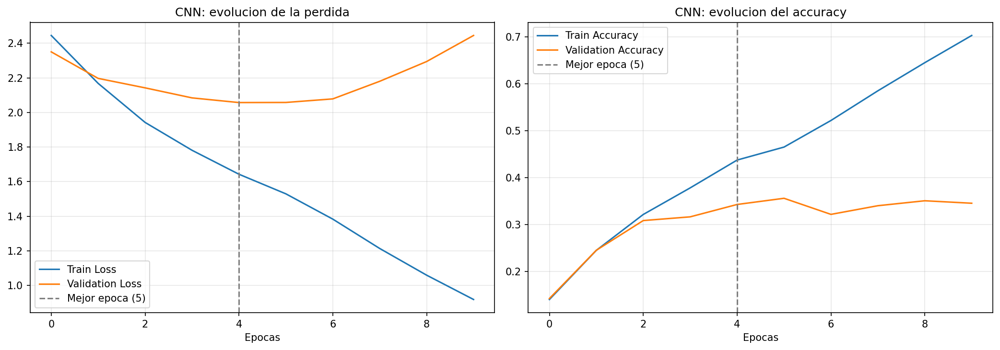

### Análisis de las curvas

- La pérdida y el accuracy de entrenamiento mejoran de forma sostenida: la red tiene capacidad para ajustarse al conjunto de entrenamiento.
- La pérdida de validación llega a un mínimo en las primeras épocas y luego vuelve a subir mientras la de entrenamiento sigue bajando, y el accuracy de validación se estanca. Es la señal clásica de sobreajuste.
- EarlyStopping detuvo el entrenamiento tras 5 épocas sin mejorar val_loss y restauró los pesos de la época 4, lo que limita el sobreajuste sin agregar capas.
- Con ~1.500 imágenes, 12 clases de grano fino y sin regularización ni augmentation, este comportamiento es esperable. La validación no comparte imágenes con el entrenamiento, por lo que sus curvas son una estimación honesta de la generalización.

---

## 6. Evaluación de la CNN

Evaluación sobre el conjunto de prueba (475 imágenes, 166 aciertos y 309 errores).

| Métrica | Valor |
|---|---|
| Accuracy | 0,349 |
| Precision (macro) | 0,40 |
| Recall (macro) | 0,35 |
| F1-Score (macro) | 0,341 |

El azar para 12 clases es ≈ 8,3 %, de modo que el modelo aprende señal real, aunque lejos de un clasificador confiable.

### Reporte por raza

| Raza | Precision | Recall | F1 | Soporte |
|---|---|---|---|---|
| Abyssinian | 0,32 | 0,17 | 0,23 | 40 |
| Bengal | 0,43 | 0,57 | 0,49 | 40 |
| Birman | 0,46 | 0,15 | 0,23 | 40 |
| Bombay | 0,59 | 0,89 | 0,71 | 37 |
| British_Shorthair | 0,24 | 0,28 | 0,26 | 40 |
| Egyptian_Mau | 0,53 | 0,24 | 0,33 | 38 |
| Maine_Coon | 0,43 | 0,25 | 0,32 | 40 |
| Persian | 0,50 | 0,20 | 0,29 | 40 |
| Ragdoll | 0,40 | 0,42 | 0,41 | 40 |
| Russian_Blue | 0,47 | 0,17 | 0,25 | 40 |
| Siamese | 0,30 | 0,40 | 0,34 | 40 |
| Sphynx | 0,16 | 0,47 | 0,24 | 40 |

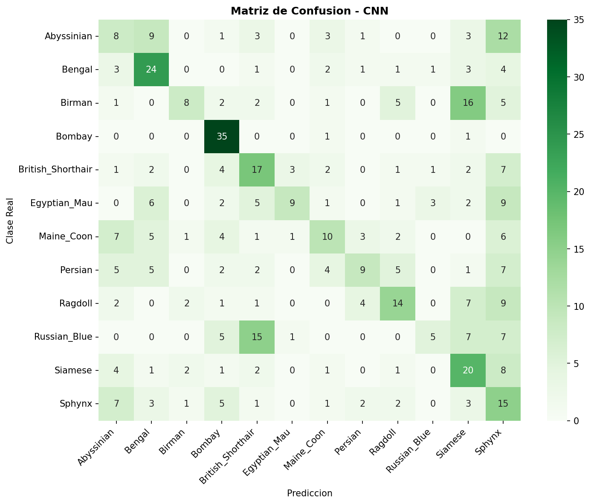

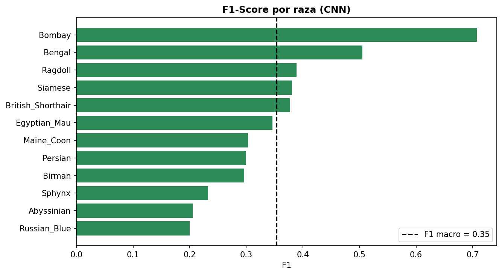

### Interpretación

- **Accuracy y F1 macro son similares** porque el conjunto de prueba está casi balanceado; no hay una clase mayoritaria que infle el accuracy.
- La brecha entre el accuracy de entrenamiento y el de prueba confirma el sobreajuste observado en las curvas: el modelo aprende rasgos específicos de las imágenes de entrenamiento que no generalizan por completo.
- **Mejor raza: Bombay (F1 0,71)**, de pelaje negro uniforme y por lo tanto muy distintiva. **Peor: Abyssinian (F1 0,23)**.
- **Sphynx** tiene recall alto (0,47) pero precision baja (0,16): el modelo la usa como clase refugio cuando duda.
- Confusiones más frecuentes (real → predicho): Birman → Siamese (14), Abyssinian → Sphynx (13), British_Shorthair → Sphynx (13), Russian_Blue → British_Shorthair (12), Maine_Coon → Sphynx (11) y Siamese → Sphynx (11). Son razas de aspecto parecido.
- A 64 × 64 px se pierde detalle fino de textura del pelaje, que es justamente lo que distingue a varias razas; esto limita el techo de desempeño.

---

## 7. Comparación entre MLP y CNN

El MLP, cargado desde models/mlp_model.keras y evaluado sin reentrenar sobre el mismo conjunto de prueba, con la misma resolución y normalización. Su arquitectura es: Flatten (12.288 valores) → Dense 128 (ReLU) → Dense 64 (ReLU) → Dense 12 (softmax), con 1.582.028 parámetros entrenables. El tiempo de entrenamiento del MLP (11,48 s para 30 épocas), porque el modelo guardado no incluye sus curvas.

### Diferencias de entrenamiento a tener presentes

| | MLP (Evaluación 1) | CNN (Evaluación 2) |
|---|---|---|
| Optimizador | SGD | Adam |
| Pérdida | categorical_crossentropy (one-hot) | sparse_categorical_crossentropy |
| EarlyStopping | patience 5, no se activó (30 épocas) | patience 5, se detuvo en la época 9 |
| Validación original | Solapada con el entrenamiento (shuffle=False) | shuffle=True, sin solapamiento |

### Resultados

| Indicador | MLP (E1) | CNN |
|---|---|---|
| Accuracy (prueba) | 0,269 | **0,349** |
| Precision macro (prueba) | 0,289 | **0,402** |
| Recall macro (prueba) | 0,272 | **0,352** |
| F1 macro (prueba) | 0,251 | **0,341** |
| Parámetros | 1.582.028 | **320.172** |
| Épocas | 30 | 9 |
| Tiempo total de entrenamiento | **11,5 s** | 79,6 s |
| Tiempo por época | **0,38 s** | 8,84 s |
| Accuracy de entrenamiento | 0,371 | 0,430 |
| Accuracy de validación (limpia) | 0,216 | **0,325** |
| Accuracy de prueba | 0,269 | **0,349** |
| Brecha train–test | 0,102 | **0,081** |

Los valores de precision y recall coinciden con `images/tabla_comparacion.csv`. La accuracy del MLP recalculada sobre esta partición (0,269) difiere levemente de la registrada en la Evaluación 1 (0,259); se usa la recalculada porque permite comparar ambos modelos sobre exactamente el mismo conjunto.

La accuracy de entrenamiento y de validación del MLP se recalcularon con el MLP guardado sobre la partición limpia de esta evaluación. La accuracy de entrenamiento de la CNN corresponde a los pesos restaurados de la época 4.

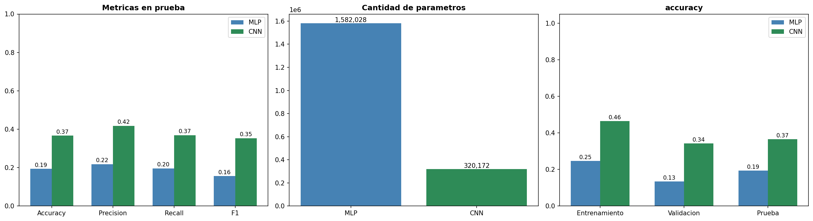

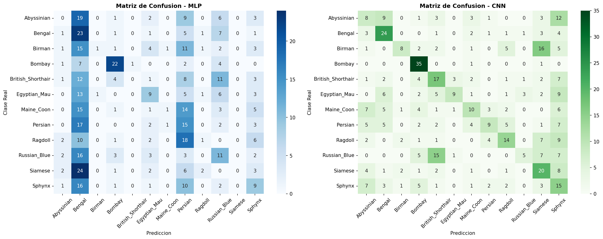

### Lectura de la evidencia

- **Desempeño:** la CNN mejora +8,0 puntos porcentuales de accuracy sobre el MLP y supera al MLP en accuracy, precision, recall y F1. En 87 imágenes de prueba la CNN acierta y el MLP falla; en 49 ocurre lo contrario.
- **Parámetros:** la CNN usa 80 % menos parámetros (320 mil frente a 1,58 millones). En el MLP casi todos los parámetros están en la primera capa densa (12.288 × 128 ≈ 1,57 M); en la CNN los filtros comparten pesos en toda la imagen.
- **Tiempo:** el MLP es más rápido por época, porque las convoluciones requieren más operaciones aunque haya menos parámetros. Los tiempos totales no son estrictamente comparables (distinto número de épocas, ejecuciones y optimizador), por eso se incluye el tiempo por época.
- **Generalización:** ambos rinden menos en prueba que en entrenamiento. La CNN tiene una brecha menor (0,081 frente a 0,102) y mejor accuracy de validación y de prueba.
- **Cautela:** el MLP y la CNN no se entrenaron con el mismo optimizador, así que parte de la diferencia podría deberse a Adam frente a SGD y no solo a la arquitectura. Además, las diferencias son moderadas sobre un conjunto de prueba de 475 imágenes.

### Ventajas y desventajas

| | MLP | CNN |
|---|---|---|
| **Ventajas** | Simple, muy rápido de entrenar y fácil de implementar | Preserva la estructura espacial; filtros con pesos compartidos detectan el mismo patrón en cualquier posición; extrae características jerárquicas automáticamente; es interpretable con Feature Maps y Grad-CAM |
| **Desventajas** | Aplana la imagen y pierde la vecindad entre píxeles; no es invariante a traslaciones; concentra los parámetros en la primera capa densa; generaliza peor | Mayor costo de cómputo por época; más decisiones de diseño; con pocos datos y sin regularización sobreajusta; depende de la resolución de entrada |

---

## 8. Análisis de ejemplos correctos e incorrectos

Se muestran predicciones de la CNN con su confianza (probabilidad softmax) y la predicción del MLP sobre la misma imagen.

## 8.1 Predicción de una imagen al azar
La figura muestra una imagen de prueba elegida al azar, con su raza real y lo que predice cada modelo junto con su probabilidad.

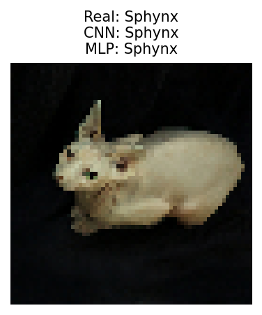

- La confianza media es 0,51 en los aciertos y 0,37 en los errores: el modelo duda más cuando se equivoca, pero la confianza no es muy alta ni siquiera en los aciertos, coherente con un modelo de bajo desempeño absoluto.
- Los errores se concentran en razas de aspecto similar (patrones de color y pelaje parecidos).
- Algunos errores se explican por la imagen misma: gatos parcialmente ocultos, poses poco comunes, fondos con mucho contenido o baja resolución a 64 × 64.
- **Fortalezas y limitaciones:** el MLP es muy rápido pero no capta forma ni textura locales; la CNN reconoce patrones locales, pero con pocos datos y sin regularización sobreajusta y su techo queda limitado.

---

## 9. Feature Maps y mapas de activación

### 9.1 Feature Maps por capa convolucional

Se visualizan las salidas de las 3 capas convolucionales para una imagen de prueba correctamente clasificada y otra mal clasificada, mostrando en cada capa los 8 mapas con mayor activación media.

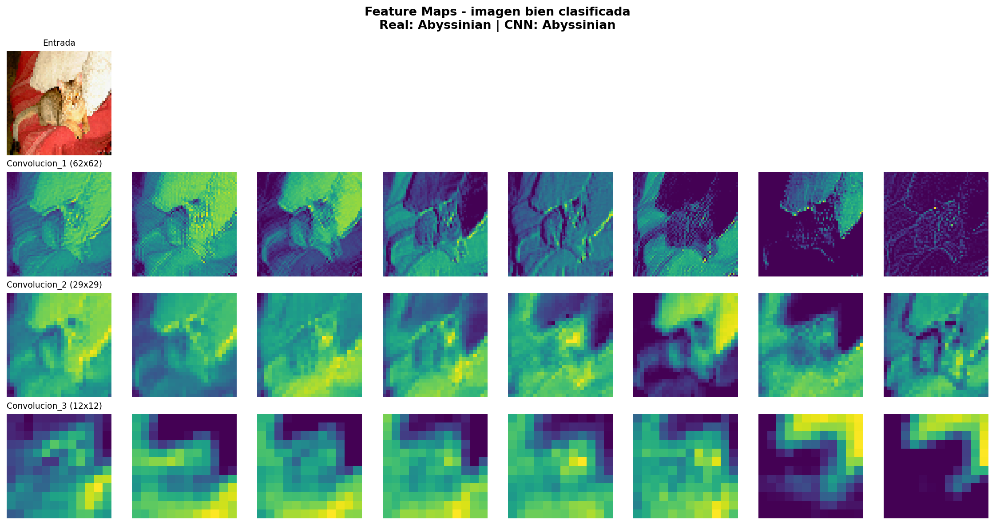

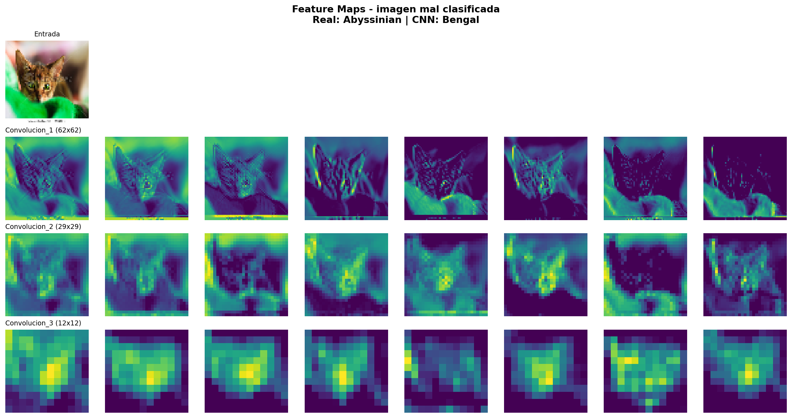

| Capa | Resolución | Qué se observa |
|---|---|---|
| Convolucion_1 (16 filtros) | 62 × 62 | Mapas casi tan detallados como la imagen: responden a bordes, contrastes, líneas y regiones de color. La silueta del gato aún se reconoce |
| Convolucion_2 (32 filtros) | 29 × 29 | Combinan bordes en texturas y contornos (pelaje, límites de orejas y cabeza). Algunos mapas empiezan a separar al gato del fondo, pero otros siguen respondiendo al fondo |
| Convolucion_3 (64 filtros) | 12 × 12 | Mapas gruesos y más abstractos: en el ejemplo mostrado, varios mapas se activan sobre regiones amplias de la imagen, incluido el fondo, y no sobre píxeles individuales. Es lo que, tras el tercer pooling (6 × 6), recibe el clasificador denso |

**Conclusión:** a mayor profundidad aumenta la abstracción y disminuye la resolución espacial: se pasa de rasgos locales simples a representaciones más abstractas. Sin embargo, en el ejemplo la última capa no siempre se activa sobre partes del gato: parte de su respuesta cae sobre el fondo. Esta extracción automática y jerárquica es el aporte central de las capas convolucionales, y es lo que el MLP no puede hacer al aplanar la imagen.

### 9.2 Mapas de activación Grad-CAM por clase
### 9.2 Grad-CAM

Grad-CAM permite visualizar las regiones de la imagen que contribuyen a la puntuación de la clase objetivo. La ubicación y distribución de las activaciones varían según la imagen y la ejecución del modelo. Por ello, la interpretación se realiza a partir de los mapas generados, comparándolos con las fotografías originales para determinar si la atención se concentra en el gato o si también incluye elementos del fondo. Estas visualizaciones permiten explorar el comportamiento del modelo, pero no demuestran por sí solas que la clasificación se base exclusivamente en rasgos relevantes de la raza.

**Análisis de las visualizaciones:** A continuación, se presentan los mapas Grad-CAM generados durante la ejecución del modelo. Su interpretación debe basarse en las regiones que efectivamente muestran las figuras y en su comparación con las imágenes originales.

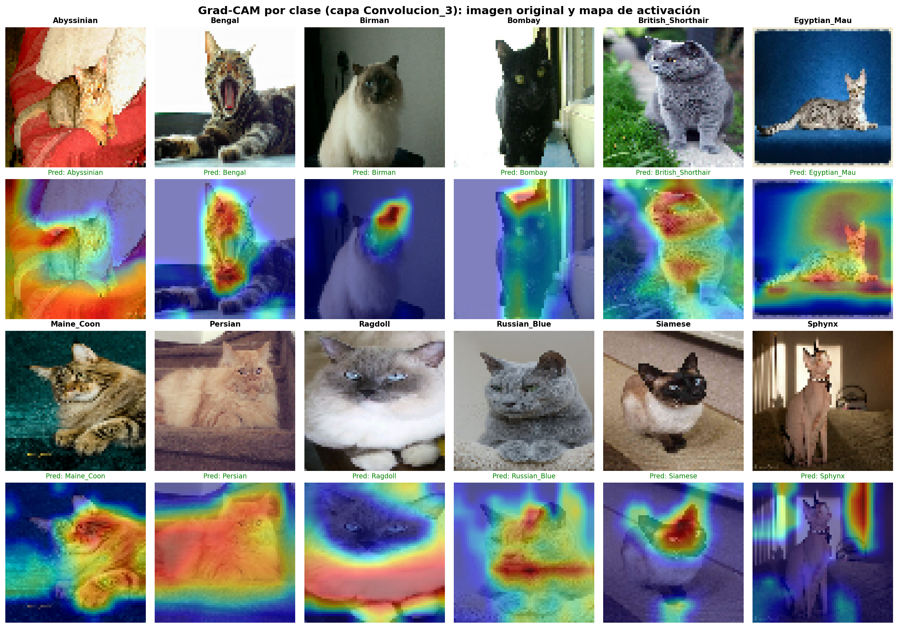

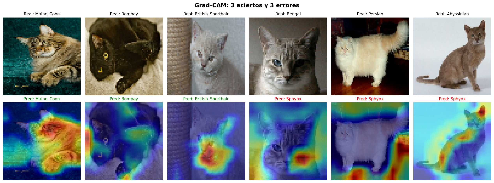

- En varias razas (por ejemplo Birman, Bengal, Siamese y Maine_Coon) el calor se concentra sobre la cabeza y el cuerpo del gato, que es la región informativa para la raza.
- En otras (por ejemplo Abyssinian, British_Shorthair y Sphynx) una parte importante del calor cae sobre el fondo o los bordes de la imagen. Esto indica que el modelo se apoya parcialmente en información de contexto, y es coherente con su bajo desempeño en esas razas.
- La última capa convolucional tiene 12 × 12 celdas, por lo que los mapas son gruesos (se reescalan a 64 × 64): sirven para ubicar la región general, no el contorno exacto.
- Las figuras cambian con cada entrenamiento; esta lectura corresponde a la ejecución documentada en el notebook.

---

## 10. Conclusiones

1. **Desempeño arquitectónico:** evaluada sobre el mismo conjunto de prueba, la CNN supera al MLP de la Evaluación 1 en Accuracy (0,349 frente a 0,269), Precision, Recall y F1 (0,341 frente a 0,251). La causa principal es arquitectónica: la CNN conserva la estructura espacial y reutiliza filtros en toda la imagen en lugar de aplanarla desde el inicio.
2. **Eficiencia:** la CNN logra ese mejor desempeño con 80 % menos parámetros, a cambio de un mayor costo de cómputo por época.
3. **Sobreajuste:** con alrededor de 1.500 imágenes de entrenamiento y 12 clases, ambos modelos rinden menos en prueba que en entrenamiento. EarlyStopping limita el sobreajuste de la CNN al detener el entrenamiento en la mejor época, pero no lo elimina.
4. **Validación del MLP:** la validación de la Evaluación 1 estaba contaminada porque se creó con shuffle=False, lo que solapaba validación y entrenamiento. Con la validación corregida, el MLP obtiene 0,216 y la CNN 0,325. La comparación válida entre ambos modelos es la del conjunto de prueba.
5. **Errores e interpretabilidad:** los errores se concentran en razas visualmente similares. Los Feature Maps muestran la jerarquía bordes → texturas → regiones con significado, y Grad-CAM permite auditar en qué zonas se apoya cada decisión y detectar posibles sesgos de contexto.

### Limitaciones

- Desempeño absoluto bajo (≈ 35 % de accuracy) para uso práctico.
- Resolución de 64 × 64 px, que pierde detalle de textura del pelaje.
- El MLP y la CNN usan distinto optimizador (SGD frente a Adam), lo que puede explicar parte de la diferencia.
- Tiempos de entrenamiento no estrictamente comparables.
- Resultados de una sola ejecución con seed fija; no se estimó la variabilidad entre ejecuciones.

### Trabajo futuro

- Aumentar la resolución de entrada (128 × 128), para recuperar detalle de textura.
- Evaluar data augmentation y transfer learning.

---

## 11. Matriz de responsabilidades

| Integrante | Tareas realizadas |
|---|---|
| **Agustín Fernández** | Preparación de datos, lógica de extracción del dataset, validación de normalización y EDA |
| **Sebastián Salgado** | Diseño e implementación de la arquitectura CNN, visualización de Feature Maps |
| **Eduardo Uribe** | Entrenamiento, evaluación comparativa CNN vs MLP (E1), análisis Grad-CAM y redacción final |

---

## 12. Reproducibilidad

- **Notebook:** notebooks/TLY1102_2_Grupo_7_CNN.ipynb. Descarga automáticamente el dataset y el modelo MLP si no existen en data/ y models/. Debe ejecutarse completo desde la carpeta notebooks/.
- **Semilla:** 29 (NumPy, random, TensorFlow y particiones).
- **Versión de TensorFlow usada:** 2.21.0.
- **Salidas:** el modelo entrenado se guarda en models/cnn_model.keras; las figuras, la tabla de comparación (tabla_comparacion.csv), el reporte de clasificación y resultados.json se guardan en images/.
- Ver README.md para las instrucciones de ejecución.
